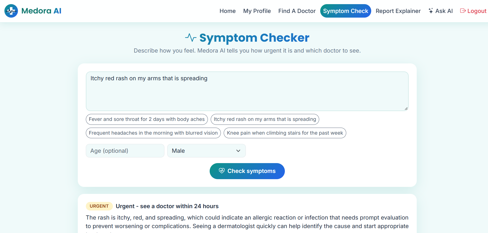
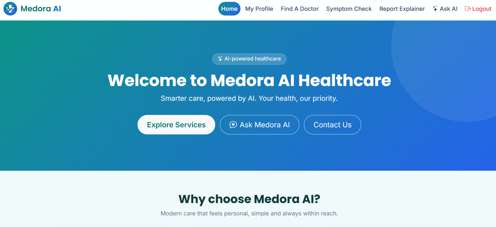
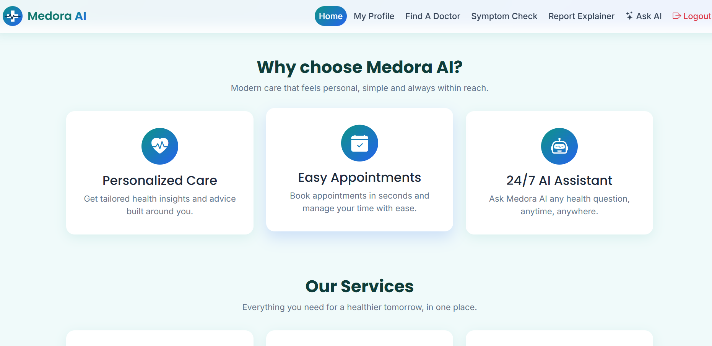
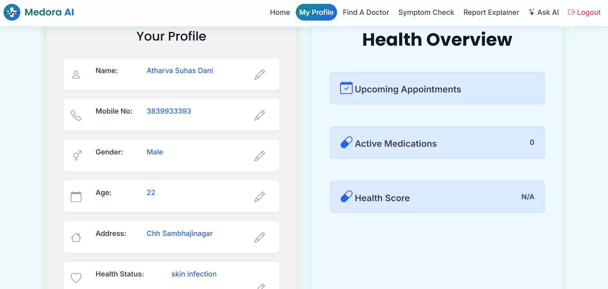
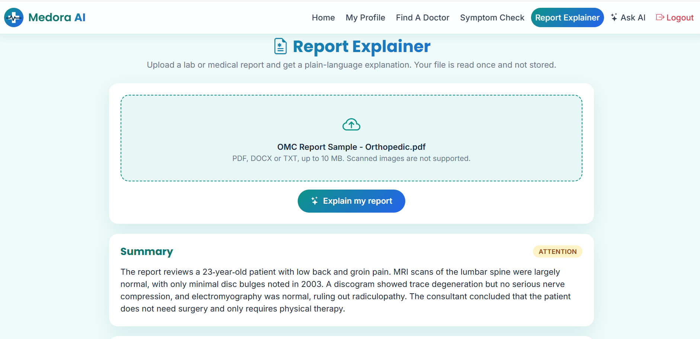
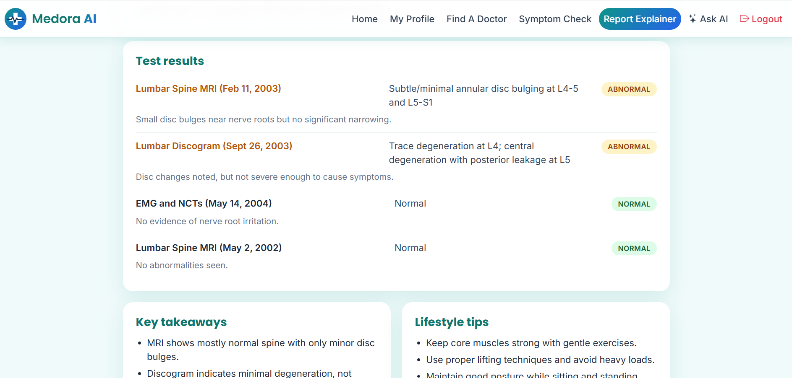
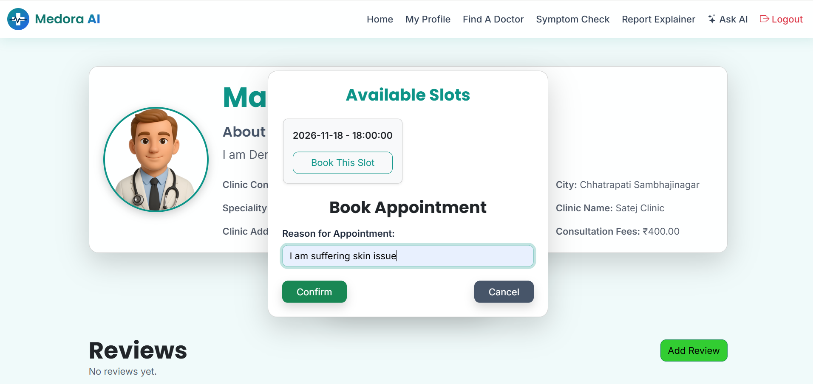
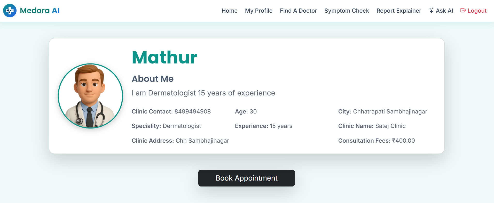
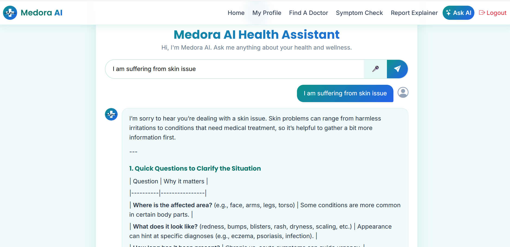
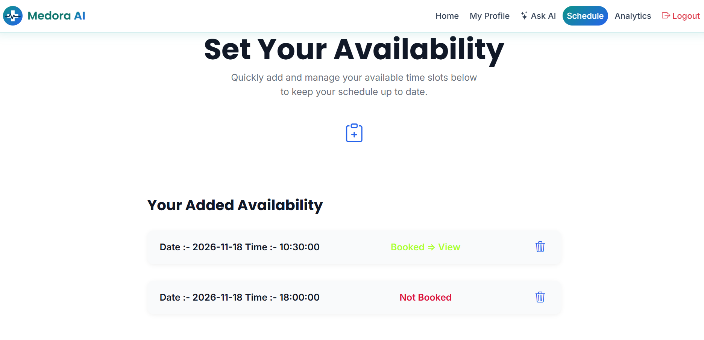

# Medora AI Healthcare

A full-stack **Healthcare Management System** with role-based login for **Patients**, **Doctors**, and **Admins**.

### ✅ Key Features

- 🩺 Appointment booking  
- 👨‍⚕️ Doctor search  
- ⭐ Feedback & rating system 
- 📅 Doctor scheduling  
- ⏰ Email Reminders  
- 🛡️ Admin moderation with misconduct , reason , analysis
-  AI chatbot with speech to text
-  AI Analysis for feedbacks , health report    summary , suggestion , healthscore

---

## Running the project

1. open Frontend folder (now **React + Vite**) in vscode, run `npm install` then `npm run dev` (opens http://localhost:4200 – the port the backend CORS config allows)
2. have mysql installed with username , password as root
3. open backend folder in intellij , run ai-service application and healthcare application
4. get a **free** API key from https://console.groq.com/keys (no credit card) and set it as environment variable `AI_API_KEY`
   (or paste it in `Backend/AI-Service/src/main/resources/application.properties` -> `ai.api.key`)
5. run ai-service and healthcare applications. Ollama is no longer needed.

### Using another free provider
Any OpenAI-compatible API works - just change `AI_BASE_URL`, `AI_MODEL`, `AI_API_KEY`:
- Groq (default): `https://api.groq.com/openai/v1` , model `llama-3.1-8b-instant`
- Google Gemini: `https://generativelanguage.googleapis.com/v1beta/openai` , model `gemini-2.0-flash`
- OpenRouter: `https://openrouter.ai/api/v1` , model `meta-llama/llama-3.3-70b-instruct:free`

#ScreenShot

## New features

| Feature | Who | Where |
|---|---|---|
| **AI Report Explainer** - upload a PDF/DOCX/TXT lab report, get a plain-language summary, per-test status (normal/high/low), tips and questions to ask the doctor. Files are read in memory and not stored. | Patient | `/patient/report-explainer` |
| **Symptom Checker / Triage** - describes symptoms -> urgency (Emergency / Urgent / Routine / Self-care) + recommended specialty, with a one-click jump to doctor search. A **rule-based red-flag detector runs before the AI**, so chest pain, stroke signs, breathing trouble, self-harm, etc. always show an emergency banner. | Patient | `/patient/symptom-checker` |
| **Video Consultation** - every appointment has its own Jitsi room. The room name is an HMAC of the appointment id, and only that appointment's patient or doctor can get it. | Patient + Doctor | Join buttons in *My Profile > Upcoming Appointments* and *Schedule > View* |
| **Analytics Dashboards** - appointments over time, busiest hours, status split, rating distribution (Recharts). Admin also sees speciality split and top-rated doctors; doctors see only their own data. | Admin + Doctor | `/admin/analytics`, `/doctor/analytics` |

### New API endpoints
- `POST /Patient/ai/explain-report` (multipart `report`) -> AI-Service `POST /ai/explain-report`
- `POST /Patient/ai/triage` `{symptoms, age?, gender?}` -> AI-Service `POST /ai/triage`
- `GET /Appointment/{id}/video-room`
- `GET /analytics/admin` (Admin only), `GET /analytics/doctor/{id}` (that doctor or Admin)

### Config
- `ai.service.url` (env `AI_SERVICE_URL`) - where the AI-Service runs, default `http://localhost:8081`
- `consultation.room-secret` (env `CONSULT_ROOM_SECRET`) - **change this** so video room names can't be guessed
- AI key: set the `AI_API_KEY` environment variable (never commit it). Default model is now `openai/gpt-oss-20b`.

### Run
1. Start MySQL, set `AI_API_KEY`, start **AI-Service** (port 8081), then **HealthCare** (port 9090).
2. `cd Frontend && npm install && npm run dev` (port 4200).
